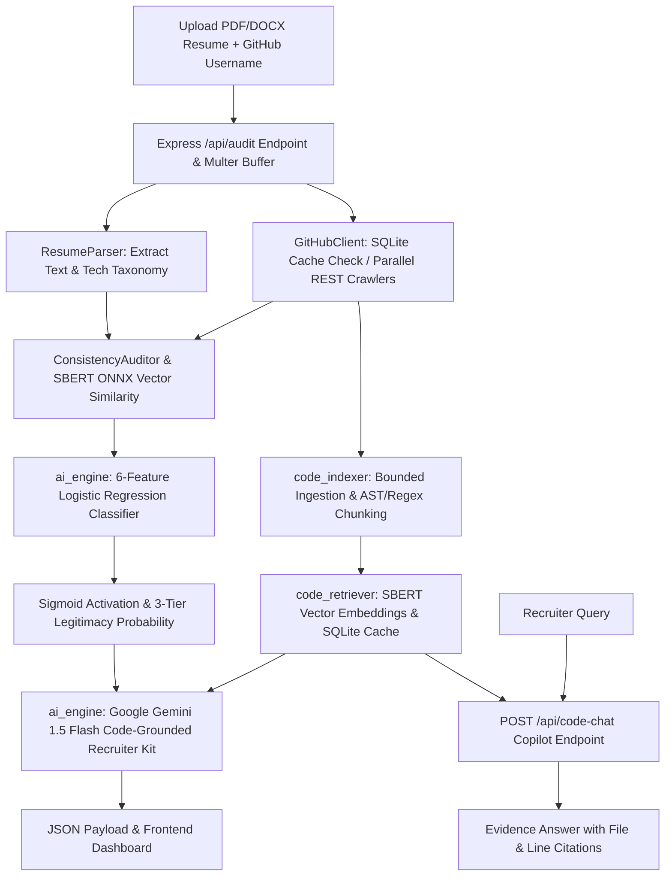

# 🛡️ GitVeritas — Resume vs. GitHub Consistency Auditor

<div align="center">

  [](LICENSE)
  [](https://nodejs.org)
  [](https://expressjs.com)
  [](https://huggingface.co)
  [](https://scikit-learn.org)
  [](https://deepmind.google/technologies/gemini)
  [](https://sqlite.org)

  **GitVeritas** is a full-stack, AI-powered developer credential verification platform. It cross-references candidates' resume claims (PDF/DOCX) against their live public GitHub code history, producing calibrated legitimacy scores, recruiter intelligence briefs, and printable credibility certificates in under 8 seconds.

  [🌐 **Live Production Deployment**](https://gitveritas.onrender.com) • [📜 **Verification Certificate Sample**](https://lnkd.in/p/dw7DcCJ2)

</div>

---

## 🌟 Key Features

* **📄 Intelligent Resume Parsing:** Extracts technical skills, package dependencies, and experience timelines from PDF and DOCX uploads using `pdf-parse` and `mammoth`.
* **🐙 Deep Concurrent GitHub Crawling:** Scrapes repositories, author-specific commit histories, pull requests, and raw package manifests (`package.json`, `requirements.txt`, `Dockerfile`) concurrently using Node.js async streams.
* **🧠 3-Layer Hybrid Semantic Matching:** Combines a 150+ keyword domain synonym taxonomy, **Sentence-BERT (`all-MiniLM-L6-v2`)** 384-dimensional vector embeddings via WebAssembly, and Jaccard bigram fuzzy matching.
* **📊 Supervised Machine Learning Classifier:** Features an L2-regularized **Logistic Regression classifier** (achieving **86.7% test accuracy** and **92.3% precision**) that evaluates 6 feature vectors to categorize claims into:
  * 🟢 **Verified Genuine ($\ge$ 70%):** Strong codebase proof, manifest dependencies, and iterative author commits.
  * 🟡 **Starter / Tutorial (40% – 69%):** Basic starter projects, school assignments, or tutorial templates.
  * 🔴 **Inflated Claim (< 40%):** Minimal or zero public repository evidence, or unedited forked repositories.
* **🤖 Generative AI Recruiter Intelligence:** Leverages **Google Gemini 1.5 Flash** with dynamic JSON schema enforcement (and a zero-latency local synthesizer fallback) to generate executive hiring summaries, code authenticity scores, and tailored technical interview questions.
* **🔬 In-Engine Code RAG Pipeline:** Indexes candidate repositories with language-aware AST chunking (JS/TS, Python, Java), sanitizes credentials/secrets, generates 384-d vector embeddings, and stores them in SQLite.
* **💬 Recruiter Codebase Copilot (`/api/code-chat`):** Interactive grounded Q&A endpoint allowing technical recruiters to query the candidate's codebase with exact file path and line citations.
* **⚡ High-Throughput Relational Caching:** Embedded **SQLite3 caching engine** prevents API rate limits, supporting **5,000+ requests/hour** on under **80MB RAM**.
* **🛡️ Dynamic Verification Certificates:** Generates printable, high-contrast credibility cards and seals rendered natively via SVG.

---

## 🔮 System Architecture



---

## 🚀 API Reference

### 1. `POST /api/audit`
Performs complete resume-to-codebase audit and Code RAG indexing.
* **Content-Type**: `multipart/form-data`
* **Parameters**:
  * `resume`: File (PDF or DOCX, max 5MB)
  * `github_username`: String
  * `github_token`: String (optional)
* **Response**:
  ```json
  {
    "success": true,
    "username": "candidate",
    "audit": { "score": 85, "verified_claims": [...], "unsupported_claims": [...] },
    "ai_recruiter_kit": {
      "executive_summary": "...",
      "code_grounded_questions": [
        {
          "topic": "AuthService",
          "repository": "ecommerce-api",
          "file_path": "controllers/auth.js",
          "line_range": "15-42",
          "question": "In controllers/auth.js lines 15-42, how did you handle token expiration?"
        }
      ]
    },
    "code_evidence": [...]
  }
  ```

### 2. `POST /api/code-chat`
Recruiter Codebase Copilot for asking technical questions about indexed repositories.
* **Content-Type**: `application/json`
* **Payload**:
  ```json
  {
    "username": "candidate",
    "question": "Where is authentication implemented?",
    "repo": "optional-repo-name",
    "github_token": "optional-token"
  }
  ```
* **Response**:
  ```json
  {
    "success": true,
    "answer": "Authentication is implemented using JWT in `controllers/auth.js`...",
    "citations": [
      { "repository": "api-service", "file_path": "controllers/auth.js", "line_range": "12-38" }
    ],
    "evidence_found": true,
    "disclaimer": "Analysis evaluates public repository evidence and cannot conclusively prove individual code authorship."
  }
  ```

---

## ⚡ Setup & Installation

### Prerequisites
* **Node.js**: `v20.x` or higher
* **npm**: `v10.x` or higher

### Quick Start

1. **Clone the repository:**
   ```bash
   git clone https://github.com/preetikaanjana/GitVeritas.git
   cd GitVeritas
   ```

2. **Install dependencies:**
   ```bash
   npm install
   ```

3. **Configure Environment Variables (Optional):**
   Copy the example environment configuration:
   ```bash
   cp .env.example .env
   ```
   Add your `GEMINI_API_KEY` to enable live LLM generation (fallback synthesizer operates automatically offline).

4. **Run Tests:**
   ```bash
   npm test
   ```

5. **Start the server:**
   ```bash
   npm start
   ```
   Open your browser and navigate to `http://localhost:8000`.

---

## 🛠️ Technology Stack

| Layer | Component | Technology | Role |
| :--- | :--- | :--- | :--- |
| **Frontend** | UI & Dashboard | Vanilla JS (ES6+), HTML5, CSS3 | Zero-build SPA with Code Evidence Explorer & Interactive Copilot Chat |
| **Backend** | REST API Server | Node.js, Express.js, Multer | Ingestion, parallel crawler coordinator & `/api/code-chat` endpoint |
| **Parsing & Chunking**| AST Code Chunker | `code_indexer.js` | Language-aware function/class parsing for JS/TS, Python, Java |
| **Caching & Vectors** | Embedded Storage | SQLite3 (`github_cache.db`) | Relational cache and vector embedding store (384-d floats) |
| **AI / Embeddings** | Vector Embeddings | `@xenova/transformers` (SBERT) | 384-dimensional dense semantic similarity via WebAssembly (ONNX Runtime) |
| **Machine Learning** | Legitimacy Classifier | Supervised Logistic Regression | Custom 6-feature probabilistic classifier (86.7% accuracy, 92.3% precision) |
| **Generative AI** | Grounded Q&A | Google Gemini 1.5 Flash LLM | Grounded interview generation & Recruiter Codebase Copilot |

---

## 🛡️ Security & Disclaimers

* **Secret Redaction**: All source files pass through automated sanitization prior to chunking or LLM transmission, scrubbing tokens (`ghp_`, `sk-`, `AIza`), AWS keys, private keys, and connection strings.
* **Prompt Injection Defense**: Repository code is treated strictly as untrusted data using explicit delimiter guards, blocking instruction overrides inside comments.
* **Authorship Disclaimer**: Analysis evaluates public repository evidence and does not conclusively verify individual personal authorship (e.g., contributions could stem from group work, starter templates, or dependencies).

---

## 📜 License

Distributed under the MIT License. See `LICENSE` for more information.

